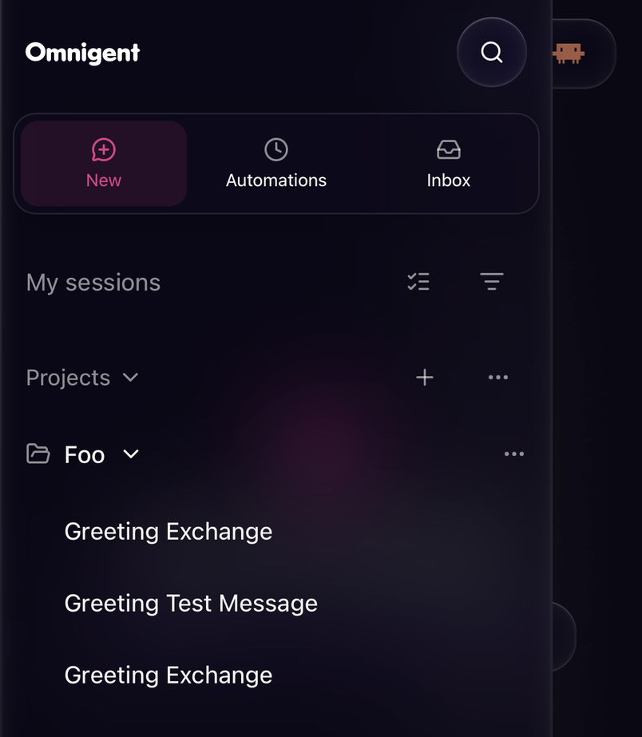

## Related issue

Closes #13482

## Summary

On a phone, the sidebar drawer's primary nav is a stack of 44pt rows above the session list: New session, Automations and Inbox take about 134pt before any optional page. This folds those three into one strip under the header of about 68pt, giving the session list about 65pt back (roughly one and a half more rows) while every target stays at least 44pt.

- **Phone drawer only:** equal-width cells, each an icon over a short label (New, Automations, Inbox), about 58pt tall, in a rounded glass container (the existing mobile glass surface). Cell labels sit 4px under the Appearance interface font size, so they follow that setting (11px at the phone default); with three cells, "Automations" fits on a 320px-wide phone. The active cell keeps the existing active highlight; the Inbox count sits on the cell's corner with an unchanged `aria-label`.
- **Rule:** the strip holds the always-on destinations (New session, Automations, Inbox; Automations keeps its existing per-user gate, so the strip can have two cells). Flag-gated pages (Canvas, Usage) and extension pages render as the normal full-width rows (the same layout as desktop) directly below the strip. The strip never scrolls, and every destination stays one visible tap away without a menu.
- **Unchanged:** the strip follows the existing overlay drawer layout (below 768px, not side by side); 768px and wider, and the side-by-side layout on wide phones, keep the stacked rows with identical classes. Links, `onNavClick` drawer closing (plain taps close, modifier-clicks don't), `componentId`s, test ids, active-route detection, and `aria-keyshortcuts` are kept. New keeps the accessible name "New session"; the hover-only shortcut hint is not rendered in the strip.
- **Shape of the change:** every primary nav item now renders through `PrimaryNavLink`, which takes a `row` or `cell` layout, so both layouts share one definition per destination; a small `PrimaryNavStrip` wraps the always-on three only on the phone drawer. As a side effect, New session, Automations, Inbox and Usage now set `aria-current="page"` when active, like Canvas and extension pages already did.

## Test Plan

- `pnpm exec vitest run src/shell/Sidebar.mobileDrawer.test.tsx src/shell/Sidebar.test.tsx src/extensions` and the other `src/shell/Sidebar*.test.tsx` files: all pass.
- New in `Sidebar.mobileDrawer.test.tsx`: strip cells on a phone (the always-on three, or two with Automations off; 44px minimum, equal width, no scrolling), New's accessible name and missing hint, active highlight with `aria-current`, the Inbox badge on the corner, drawer closing on plain taps but not modifier clicks, Canvas (active) and Usage as full-width rows below the strip, and stacked rows on desktop and side-by-side layouts. `Sidebar.test.tsx` adds an extension page rendered as a row below the strip.
- Existing desktop row assertions (classes, badge treatment, shortcut hint) pass unchanged.
- `tsc -b` and the pre-commit hooks pass.
- E2E UI tests that use these test ids at phone width (Canvas, Automations) still find and click the same elements; they were read, not rerun.

## Demo

iPhone, dark theme. New, Automations and Inbox share one strip under the header, and the project list starts right below it:

- [x] Visual demo attached below
- [ ] Non-visual evidence provided below or in Test Plan
- [ ] Not applicable — no behavioral change

## Type of change

- [ ] Bug fix
- [x] Feature
- [x] UI / frontend change
- [ ] Refactor / chore
- [ ] Docs
- [ ] Test / CI
- [ ] Breaking change

## Test coverage

- [x] Unit tests added / updated
- [ ] Integration tests added / updated
- [ ] E2E tests added / updated
- [ ] Manual verification completed
- [x] Existing tests cover this change
- [ ] Not applicable

## Coverage notes

Component tests cover the layout switch, accessibility names, active state, badge and drawer closing. Visual proportions on a real phone come with the screenshots.

## Release notes

Should this change be included in the release notes? Choose exactly one.

- [x] No — no noteworthy user-facing change.
- [ ] Yes — include the entry in the Changelog section.

🤖 Generated with [Claude Code](https://claude.com/claude-code)

