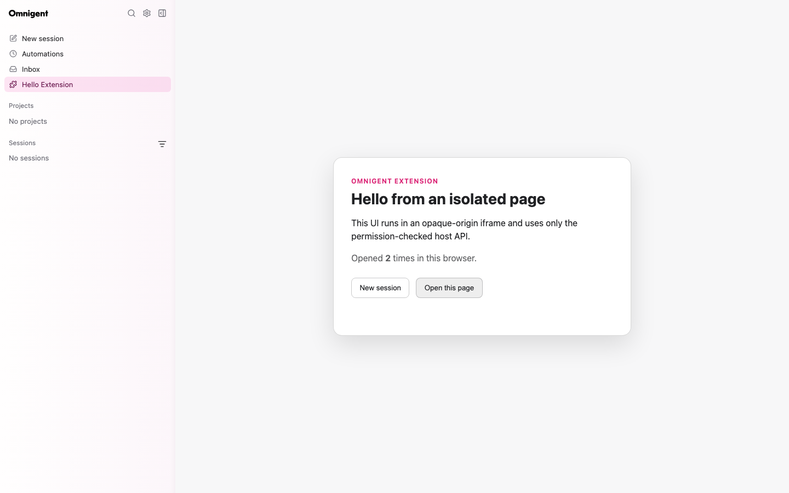

# Extensions

Omnigent extensions are operator-installed Python distributions that contribute
validated application metadata. V1 supports namespaced browser pages and links
in the primary sidebar.

## Trust model

Installing a Python distribution is a full-code-trust operation: Python entry
points execute in the Omnigent server process while their manifests are loaded.
Only administrators should install extension packages.

Browser UI receives a separate boundary. It runs in an opaque-origin sandboxed
iframe, cannot access the parent React tree, cookies, authenticated transport,
or native bridges, and has no network egress. Privileged actions use the
versioned, permission-checked browser SDK.

```text
trusted Python package -> validated manifest -> server catalog
                                                |
                                      sandboxed browser page
                                                |
                                      checked MessageChannel API
```

## V1 contribution points

- `pages`: one-segment routes under `/extensions/{extension_id}/{route}`.
- `primary_navigation`: links rendered in the extension-owned slot between
  Inbox and Usage. `order` sorts only within that slot.
- `slot_items`: core-rendered, page-backed links in four semantic UI locations,
  and label-bound items on sidebar session rows. See
  [Extension UI slots](extension_ui_slots.md).
- `labels`: ordinary session labels whose keys and values the extension
  declares, for its session-row items and its pages to write.

Activation events and `when` expressions are validated and reserved but are not
evaluated in V1. Commands with a `SetState` or `ClearState` action run on the
server; see [Extension session state](extension_state.md). Arbitrary React components,
DOM selectors, FastAPI routers, runner tools, and user-installed marketplace
packages are not supported.

## Installation and diagnostics

Declare an `omnigent.extensions` entry point, install the wheel in the server's
Python environment, and restart the server.

Installing an extension serves its V1 pages, primary navigation and browser
bundle. Its [UI slot](extension_ui_slots.md) items render only after an operator
enables it in the server config:

```yaml
extensions:
  omnigent.hello-page:
    enabled: true
```

`omnigent server` reads the file passed to `-c`, otherwise
`$OMNIGENT_CONFIG_HOME/config.yaml` (default `~/.omnigent/config.yaml`). The
Docker image and `omni extensions list` read `$OMNIGENT_CONFIG`, otherwise
`<data_dir>/config.yaml` (default `~/.omnigent/config.yaml`).

| `extensions` section | V1 pages, navigation and bundle | Slot items |
| --- | --- | --- |
| absent | shown | not shown |
| null (a bare `extensions:`) | shown | not shown |
| `{}` | shown | not shown |
| extension not listed | shown | not shown |
| `enabled: false` | not shown | not shown |
| `enabled: true` | shown | shown |

A malformed section or an invalid entry counts as not listed and logs a warning
at startup.
`enabled` is the only setting this version accepts, until this section and the
proposed backend-extension configuration share one parser: any other key under
an extension stops the server with an error naming it. Restart the server after
changing the section.

```bash
omni extensions list    # status: enabled, or installed, not enabled
omni extensions doctor publisher.extension
omni extensions legacy-labels <database URL>   # ext. labels from before core reserved them
```

A broken extension does not stop healthy extensions or the server. Public
catalog entries omit rejected extensions. Administrators can inspect concise
load and asset errors through `doctor` or `/v1/extensions/diagnostics`.



See [Extension manifest](extension_manifest.md),
[Browser extensions](browser_extensions.md),
[Extension UI slots](extension_ui_slots.md), and the
[Hello Page example](../../examples/extensions/hello-page/README.md).
